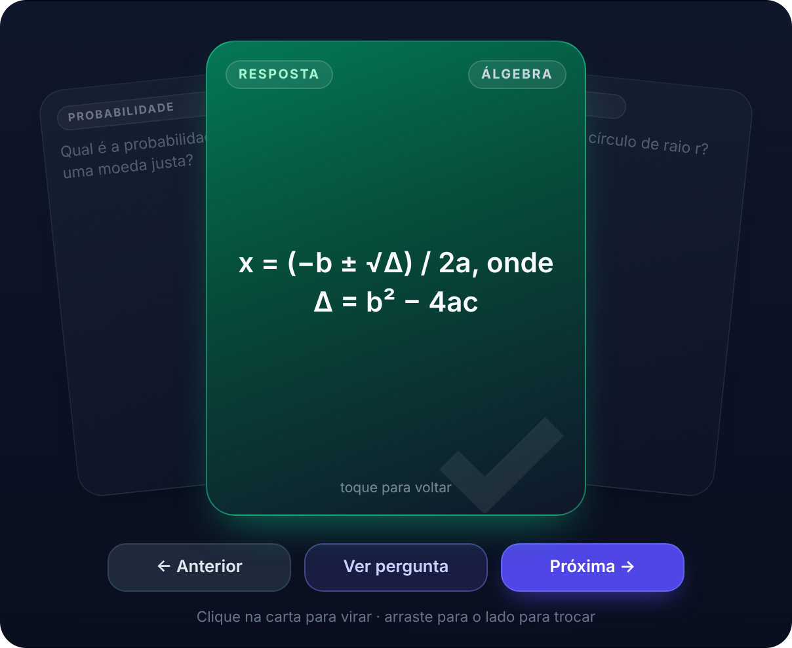
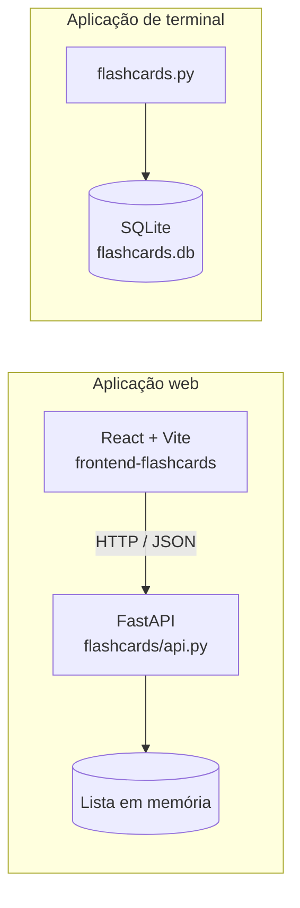

<div align="center">

# Study Flashcards 🃏 

**Estude com um baralho de cartas que vira ao toque e troca de carta ao arrastar.**
Crie seus próprios flashcards sobre qualquer assunto e revise com uma interface web fluida e responsiva.


<br>


<br>

[Sobre](#sobre) · [Demonstração](#demonstração) · [Funcionalidades](#funcionalidades) · [Como funciona](#como-funciona) · [Como executar](#como-executar) · [API](#api) · [Destaques técnicos](#destaques-técnicos) · [Roadmap](#roadmap)

</div>

---

## Sobre

O **Study Flashcards** é um projeto de estudo full stack para criar e revisar flashcards de **qualquer matéria**: você escreve a pergunta, a resposta e uma categoria, e depois estuda com um baralho interativo.

O repositório reúne duas aplicações que compartilham a mesma ideia:

- **Aplicação web**: front end em **React** conversando com uma **API REST em FastAPI**. É a versão principal do projeto.
- **Aplicação de terminal**: a primeira versão do projeto, em Python puro com **SQLite**, mantida no repositório.

---

## Demonstração

<div align="center">

<table>
  <tr>
    <td align="center">
      <br>
      <sub><b>Carta virada</b><br>clique para ver a resposta</sub>
    </td>
    <td align="center">
      <br>
      <sub><b>Arrastando</b><br>puxe para o lado para trocar</sub>
    </td>
    <td align="center">
      <br>
      <sub><b>No celular</b><br>responsivo e com gestos de toque</sub>
    </td>
  </tr>
</table>

</div>

---

## Funcionalidades

### Aplicação web

- **Duas telas simples.** A tela inicial é a de **criar**; o botão **Ver flashcards (N)** aparece abaixo do formulário apenas quando já existe pelo menos um card. Na tela de **estudo**, o botão **+ Criar** fica ao lado de **Editar** e **Apagar**.
- **Baralho de três cartas.** A carta do meio é a atual, e as vizinhas (anterior e próxima) aparecem inclinadas atrás dela.
- **Carta que vira em 3D.** Um clique mostra a resposta, com animação de giro.
- **Troca por gesto.** Arraste para a **direita** para a próxima carta e para a **esquerda** para a anterior. Funciona com mouse, dedo e caneta.
- **Navegação circular.** Voltar na primeira carta leva à última, e avançar na última volta à primeira.
- **CRUD completo.** Criar, listar, editar e apagar flashcards pela API.
- **Categorias e filtros.** Organize os cards por assunto e estude uma categoria de cada vez.
- **Progresso.** Barra de progresso do baralho e contador de cartas revisadas na sessão.
- **Responsivo e acessível.** Funciona do celular ao desktop, tem navegação por teclado e respeita a preferência de movimento reduzido do sistema.

### Aplicação de terminal

- Menu com **criar**, **estudar** (cards em ordem aleatória), **editar** e **excluir** (um card ou todos).
- Dados persistidos em **SQLite**.
- Validação das entradas: campos vazios e opções inválidas são tratados sem quebrar o programa.

---

## Como funciona



O front end carrega a lista de cards uma única vez (`GET /flashcards`) e a mantém na memória do navegador. Por isso, avançar ou voltar no baralho não faz nenhuma requisição extra. Criar, editar e apagar enviam `POST`, `PUT` e `DELETE` para a API e recarregam a lista.

> [!WARNING]
> **Limitação atual:** a API web guarda os cards **em memória** (uma lista Python). Quando o servidor reinicia, os cards são perdidos. A aplicação de terminal usa um banco SQLite próprio e **não** compartilha dados com a API. Persistir a API no SQLite é o primeiro item do [roadmap](#roadmap).

---

## Tecnologias

| Camada | Tecnologia | Para quê |
| --- | --- | --- |
| Back end | [Python](https://www.python.org/) | Linguagem do servidor e da versão de terminal |
| | [FastAPI](https://fastapi.tiangolo.com/) | API REST com documentação automática |
| | [Pydantic](https://docs.pydantic.dev/) | Validação dos dados recebidos |
| | [Uvicorn](https://www.uvicorn.org/) | Servidor que roda a API |
| | [SQLite](https://www.sqlite.org/) | Banco de dados da versão de terminal |
| Front end | [React 19](https://react.dev/) | Interface e estado da aplicação |
| | [Vite 8](https://vite.dev/) | Servidor de desenvolvimento e build |
| | [Tailwind CSS 4](https://tailwindcss.com/) | Estilo das telas de criar e estudar |
| | CSS próprio | Baralho: giro 3D, inclinação e transições |
| | [Oxlint](https://oxc.rs/docs/guide/usage/linter) | Análise estática do código |

---

## Estrutura do projeto

```text
study-flashcards/
├── README.md
├── .gitignore
├── docs/                         # imagens usadas neste README
├── flashcards/
│   ├── api.py                    # API REST (FastAPI)
│   └── flashcards.py             # versão de terminal (SQLite)
└── frontend-flashcards/
    ├── index.html
    ├── package.json
    ├── vite.config.js
    └── src/
        ├── main.jsx              # ponto de entrada do React
        ├── App.jsx               # telas de criar/estudar e comunicação com a API
        ├── Baralho.jsx           # baralho: virar, arrastar e navegar
        ├── Baralho.css           # visual do baralho
        └── index.css             # estilos globais e Tailwind
```

---

## Como executar

### Pré-requisitos

- **Python 3.10** ou superior
- **Node.js 20.19** ou superior (ou 22.12+), com `npm`
- **Git**

### 1. Clonar o repositório

```bash
git clone https://github.com/gusegundo/study-flashcards.git
cd study-flashcards
```

### 2. Rodar a API (terminal 1)

```bash
cd flashcards
python3 -m venv .venv

# Linux / macOS
source .venv/bin/activate
# Windows (PowerShell)
# .venv\Scripts\Activate.ps1

pip install "fastapi[standard]"
uvicorn api:app --reload
```

A API fica em `http://127.0.0.1:8000`. A documentação interativa (Swagger) abre em `http://127.0.0.1:8000/docs`, onde dá para testar cada rota pelo navegador.

### 3. Rodar o front end (terminal 2)

```bash
cd frontend-flashcards
npm install
npm run dev
```

Abra o endereço que o Vite mostrar no terminal (normalmente `http://localhost:5173`).

> [!NOTE]
> O front end procura a API em `http://127.0.0.1:8000`. Se você mudar a porta da API, ajuste esse endereço no `src/App.jsx`.

### Scripts do front end

| Comando | O que faz |
| --- | --- |
| `npm run dev` | Inicia o servidor de desenvolvimento |
| `npm run build` | Gera a versão de produção em `dist/` |
| `npm run preview` | Serve localmente a versão gerada pelo build |
| `npm run lint` | Analisa o código com o Oxlint |

### Versão de terminal (opcional)

```bash
cd flashcards
python3 flashcards.py
```

O banco `flashcards.db` é criado automaticamente na primeira execução, ao lado do `flashcards.py`.

---

## API

Base: `http://127.0.0.1:8000`

| Método | Rota | Descrição |
| --- | --- | --- |
| `GET` | `/flashcards` | Lista todos os flashcards |
| `POST` | `/flashcards` | Cria um flashcard |
| `PUT` | `/flashcards/{id}` | Atualiza um flashcard |
| `DELETE` | `/flashcards/{id}` | Remove um flashcard |

**Corpo do `POST` e do `PUT`**

```json
{
  "enunciado": "Qual é a derivada de x²?",
  "resposta": "2x",
  "categoria": "Cálculo"
}
```

`categoria` é opcional; quando não é enviada, o valor padrão é `"Geral"`.

**Resposta do `GET /flashcards`**

```json
{
  "flashcards": [
    {
      "id": 1,
      "enunciado": "Qual é a derivada de x²?",
      "resposta": "2x",
      "categoria": "Cálculo"
    }
  ]
}
```

**Exemplo com `curl`**

```bash
curl -X POST http://127.0.0.1:8000/flashcards \
  -H "Content-Type: application/json" \
  -d '{"enunciado": "Qual é a área de um círculo?", "resposta": "A = π · r²", "categoria": "Geometria"}'
```

Se o `id` não existir, `PUT` e `DELETE` respondem `404` com `{"detail": "Flashcard não encontrado"}`.

> [!NOTE]
> O CORS está liberado para qualquer origem (`allow_origins=["*"]`) para facilitar o desenvolvimento. Em produção, restrinja para o endereço do front end.

---

## Controles do baralho

| Ação | Resultado |
| --- | --- |
| Clicar ou tocar na carta do meio | Vira a carta (pergunta ↔ resposta) |
| Arrastar para a **direita** | Próxima carta |
| Arrastar para a **esquerda** | Carta anterior |
| Arrasto curto e rápido (peteleco) | Também troca de carta |
| Arrasto curto e lento | A carta volta para o lugar |
| `→` e `←` no teclado | Próxima e anterior |
| `Enter` ou `Espaço` com a carta em foco | Vira a carta |
| Botões **Anterior**, **Ver resposta** e **Próxima** | Fazem o mesmo que os gestos |

---

## Destaques técnicos

**Arrastar sem biblioteca.** O gesto foi feito com **Pointer Events** do navegador, que tratam mouse, toque e caneta pelo mesmo código. O componente `Baralho.jsx` usa `setPointerCapture` para continuar recebendo o movimento mesmo se o ponteiro sair da carta, e separa **clique** de **arrasto** por um limite de 6 px. A troca acontece quando o arrasto passa de 90 px ou quando é um peteleco rápido.

**Giro 3D só com CSS.** Frente e verso ficam empilhados; o verso nasce girado em 180° e `backface-visibility: hidden` esconde o lado de trás. Ao virar, o `Baralho.css` gira o contêiner com `rotateY(180deg)` dentro de uma `perspective`.

**Gesto de toque que não é "roubado".** A área de texto da carta rola quando o conteúdo é grande e, por isso, o navegador cancelava o arrasto no celular quando o dedo começava em cima do texto. A correção foi aplicar `touch-action: pan-y` em **todos os elementos dentro da carta**, deixando a rolagem vertical com o navegador e o gesto horizontal com o componente.

**Navegação circular sem requisições.** A lista fica na memória do front end, e as cartas vizinhas são calculadas por índice com módulo: `(i + 1) % n` e `(i - 1 + n) % n`.

**Telas que não deixam o usuário preso.** Apagar o último card volta sozinho para a tela de criar, e apagar o último card de uma categoria filtrada devolve o filtro para "Todas".

**Acessibilidade.** A carta tem `role="button"` e `aria-pressed`, aceita `Enter` e `Espaço`, as setas do teclado trocam de carta (sem atrapalhar quem digita num campo) e `prefers-reduced-motion` reduz as animações.

---

## Roadmap

**Concluído**

- [x] Aplicação de terminal com SQLite (criar, estudar, editar e excluir)
- [x] API REST em FastAPI com CRUD completo
- [x] Interface web em React integrada à API
- [x] Categorias e filtro por categoria
- [x] Baralho de três cartas com giro 3D e gestos de arrastar
- [x] Telas separadas de criar e estudar

**Próximos passos**

- [ ] Persistir os cards da API no **SQLite** (hoje ficam em memória)
- [ ] Modo estudo com **verificação de respostas** (digitar e comparar com a resposta do card)
- [ ] Estatísticas de desempenho (acertos e erros por categoria)
- [ ] Repetição espaçada
- [ ] Configurar o endereço da API por variável de ambiente
- [ ] Adicionar um `requirements.txt` para o back end
- [ ] Testes automatizados
- [ ] Publicar online (deploy)

---

## Autor

Projeto de estudo desenvolvido por **Gustavo** ([@gusegundo](https://github.com/gusegundo)).

Sugestões e feedback são bem-vindos: abra uma [issue](https://github.com/gusegundo/study-flashcards/issues) neste repositório.